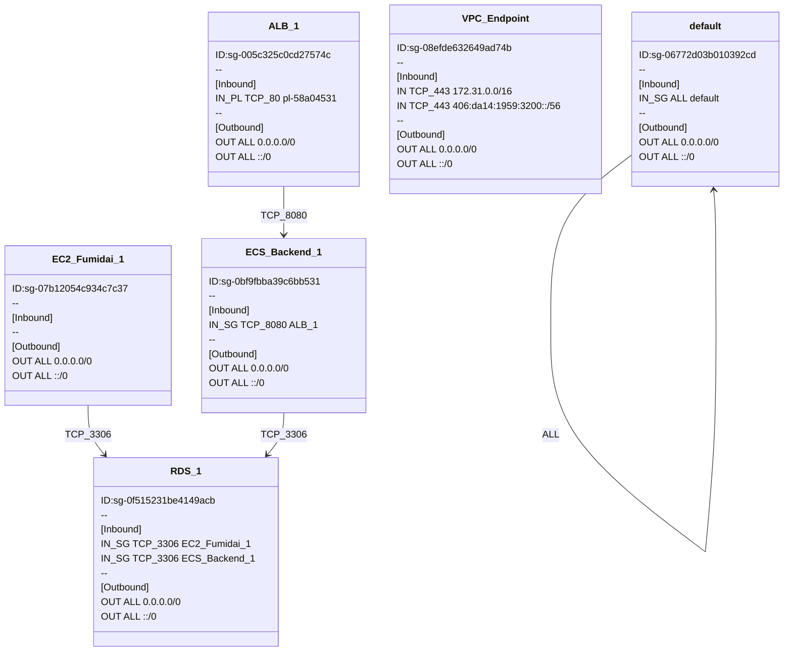

# AWSのセキュリティグループを可視化して設定確認を楽にする

セキュリティグループの関係を、実際の AWS 環境から設定を取得して Mermaid 図として出力するツールを作成しました。

コマンド名はsgzuで、お察しの通り、

sg = セキュリティグループ
zu = 図

です。覚えやすいですね。覚えていってください。

できること

* セキュリティグループ間の許可関係を可視化
* インバウンド / アウトバウンドルールを一覧表示
* Mermaid ダイアグラムとして出力

## なぜこれを作成したのか

AWS コンソールでは、セキュリティグループは一覧形式で表示されます。

セキュリティグループの設定ミスを調査したり、構築された環境が設計どおりになっているか確認したりする場合、この作業は非常に手間がかかります。
つまり、こういうことになるわけですね。

リソースからセキュリティグループを見る
→ セキュリティグループの設定を表示する
→ リソースによって表示のしかたが違うのにキレる
→ 通信先、元のセキュリティグループを表示する
→ まちがってセキュリティルールIDを見てしまう
→ ブラウザのタブが増える
→ どのタブでなにを表示していたのかわからなくなる
→ 余分なタブを閉じる
→ 余分でないタブも閉じてしまう
→ 最初に戻る

このような無駄な作業を減らすために、このツールを作成しました。

コードはAIが生成したものを利用目的に合わせて修正したものです。
設計上の方針として、

- セキュリティグループを主体とする
- リソースは表示しない
- インバウンドルールを元に通信関係を可視化する
- 図が複雑になりすぎるためアウトバウンド矢印は出力しない

としています。

## インストール

[TOOLBOX](https://github.com/enchanter-rndevops/toolbox) から git clone でソースを取得。
pipxで TOOLBOX をインストールすると、sgzuがインストールされます。

## 使う

aws にログイン

```
$ aws login
```

図を生成
生成結果は標準出力に出力されます。
適当なファイルへリダイレクトし、Markdownファイルへコピーしてください。

```
$ sgzu 


## 読み方

このツールが出力するのはセキュリティグループのみです。
EC2、ALB、ECS、RDSなどのリソースは出力されません。

ボックスの見出しはセキュリティグループ名です。
セキュリティグループIDとインバウンド、アウトバウンドをすべて表示しています。

矢印はインバウンド設定をもとに書いています。アウトバウンドの設定によっては、矢印があっても実際に通信が通らない場合があります。


## さいごに 

セキュリティグループの設定確認や設計レビューの際に、AWS コンソールを何往復もする代わりに sgzu を使って全体像を確認できるようになりました。

同じ悩みを持っている方の参考になれば幸いです。
