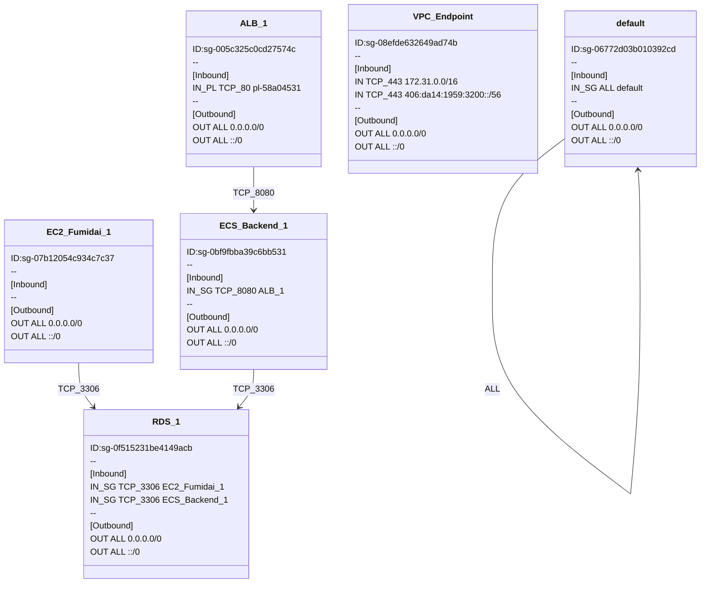

# セキュリティグループの図を生成

セキュリティグループの関係を、実際の AWS 環境から設定を取得して Mermaid 図として出力するツールを作成しました。

コマンド名はsgzuで、お察しの通り、

sg = セキュリティグループ
zu = 図

です。覚えやすいですね。覚えていってください。

## なぜ作ったの？

AWS コンソールでは、セキュリティグループは一覧形式で表示されます。

セキュリティグループの設定ミスを調査したり、構築された環境が設計どおりになっているか確認したりする場合、この作業は非常に手間がかかります。
つまり、こういうことになるわけですね。

リソースからセキュリティグループを見る
→ セキュリティグループの設定を表示する
→ リソースによって表示のしかたが違うのにキレる
→ 通信先、元のセキュリティグループを表示する
→ まちがってセキュリティルールIDを見てしまう
→ ブラウザのタブが増える
→ どのタブでなにを表示していたのかわからなくなる
→ 余分なタブを閉じる
→ 余分でないタブも閉じてしまう
→ 最初に戻る

このような無駄な作業を減らすために、このツールを作成しました。

Security Groupのインバウンドだけ見ていると通信できるように見えることがあります。しかし、実際には送信元Security Groupのアウトバウンド設定によって通信できない場合があります。sgzuはインバウンド・アウトバウンドの両方を一覧表示するため、設定ミスを発見しやすくなります。

できること

* セキュリティグループ間の許可関係を可視化
* インバウンド / アウトバウンドルールを一覧表示
* Mermaid ダイアグラムとして出力

## 使う

pipxでインストールしておく。

aws にログイン

```
$ aws login
```

図を生成
```
$ sgzu 
```

## 出力例

出力されるのはセキュリティグループのみです。
セキュリティグループが設定されているリソースは出力されません。

ボックスの見出しはセキュリティグループ名です。
セキュリティグループIDとインバウンド、アウトバウンドをすべて表示しています。

矢印はインバウンド設定をもとに書いています。アウトバウンドの設定によっては、矢印があっても実際に通信が通らない場合があります。


